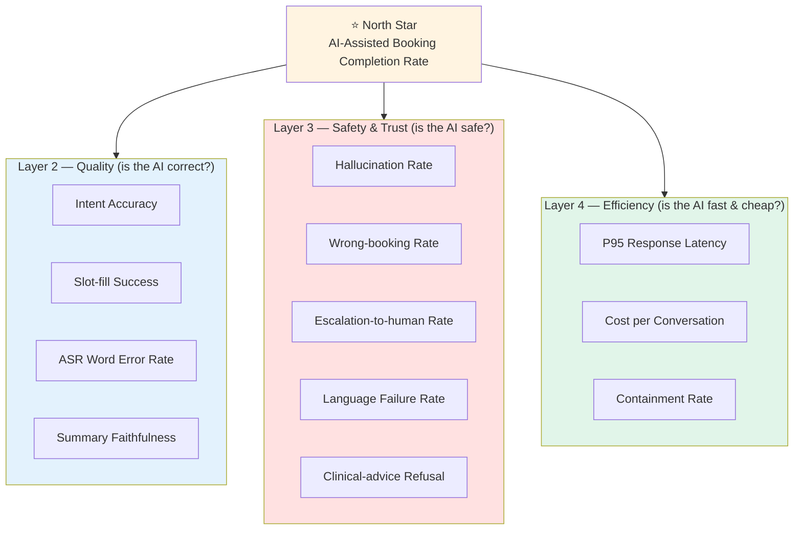
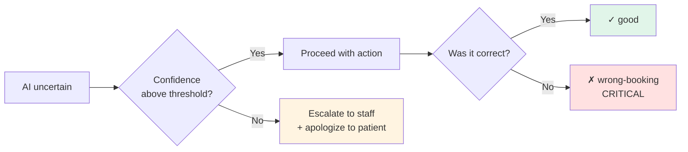
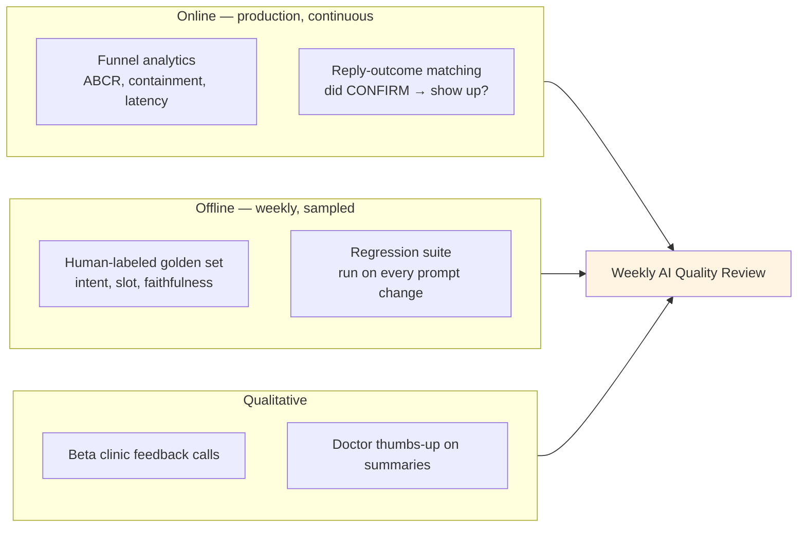

# AI Product Metrics
## AI-Powered Appointment Booking System for Indian Dental Clinics

**Date:** October 19, 2026
**Version:** 1.0
**Document Owner:** Product Manager

---

## Executive Summary

This document defines the metrics framework for the **AI components** of the product — distinct from the business KPIs in the PRD (no-show rate, MRR). Business metrics tell us *whether the product works*; AI metrics tell us *whether the AI is good enough to make it work*, and *where it breaks*.

The product has four AI surfaces:

| # | AI Surface | What it does | Model/Stack |
|---|-----------|--------------|-------------|
| 1 | **WhatsApp NLP bot** | Intent detection, slot-filling, Hindi/English code-switching | Keyword match + GPT-4 fallback |
| 2 | **Voice AI** | Hindi/English phone bookings | Vapi.ai (ASR + LLM + TTS) |
| 3 | **Reminder/engagement AI** | Reply parsing (CONFIRM/CANCEL), no-show risk scoring | Classifier + rules |
| 4 | **Dashboard summary AI** | Generates daily/weekly WhatsApp briefs for doctors | GPT-4 summarization |

**Guiding principle:** Every AI metric must ladder up to a business outcome. We do not track model accuracy for its own sake — we track it because a misread intent is a lost booking, and a hallucinated summary is a doctor making a bad call on wrong numbers.

---

## Metrics Framework

We organize metrics into four layers. Each layer answers a different question.



- **North Star** — the single number that says the AI is delivering value.
- **Layer 2 (Quality)** — is the AI producing correct output?
- **Layer 3 (Safety & Trust)** — when it's wrong, how bad is it, and does it fail gracefully?
- **Layer 4 (Efficiency)** — can we afford to run it at the speed users expect?

---

## North Star Metric

### AI-Assisted Booking Completion Rate

> **% of patient-initiated AI conversations (WhatsApp or Voice) that result in a confirmed booking without human staff intervention.**

```
                 Bookings confirmed via AI, zero staff touch
ABCR  =  ───────────────────────────────────────────────────────  × 100
              Total patient-initiated AI booking conversations
```

**Why this is the North Star:**
- Directly ties AI quality to the core value prop (booking automation → no-show reduction → ₹30k/month saved).
- A single AI failure anywhere in the funnel (misread intent, wrong slot, dead-end conversation) drops this number — so it's a natural integrator of all downstream quality.
- It explicitly excludes human rescue, so it measures the AI, not the staff cleaning up after it.

| | Baseline (keyword-only) | Beta Target | GA Target |
|---|---|---|---|
| **ABCR** | ~55% | 70% | 82% |

**Counter-metric (guardrail):** We will *not* chase ABCR by letting the bot force-book when unsure. ABCR must rise *alongside* a flat-or-falling **Wrong-booking Rate** (see Layer 3). A high ABCR with rising wrong-bookings is a regression, not a win.

---

## Layer 2 — Quality Metrics

### 2.1 WhatsApp NLP Bot

| Metric | Definition | Target (GA) | Why it matters |
|--------|-----------|-------------|----------------|
| **Intent Accuracy** | % of first messages routed to the correct intent (book / reschedule / cancel / FAQ / other) | ≥ 92% | A wrong intent at message 1 poisons the whole conversation |
| **Slot-filling Success** | % of bookings where name, phone, doctor, date, time all captured correctly without re-prompting > 2× | ≥ 85% | Each re-prompt is a drop-off risk |
| **Code-switch Handling** | Intent accuracy on mixed Hindi-English ("kal 6 baje ka slot hai?") | ≥ 88% | ~40% of real messages are code-switched; English-only accuracy hides this |
| **GPT-4 Fallback Precision** | When keyword match fails and GPT-4 takes over, % of correct resolutions | ≥ 90% | Fallback is our most expensive path; it must earn its cost |

**Measurement:** Weekly human-labeled sample of 200 conversations (stratified: 50% Hindi-dominant, 30% code-switched, 20% English). Labelers mark intent + slot correctness against actual booking outcome.

### 2.2 Voice AI (Vapi)

| Metric | Definition | Target (GA) | Why it matters |
|--------|-----------|-------------|----------------|
| **Word Error Rate (WER)** | ASR transcription errors, measured separately for Hindi & English | ≤ 12% (EN), ≤ 18% (HI) | Phone audio + accents + background noise; Hindi ASR is the weak link |
| **Call Completion Rate** | % of calls that reach a terminal state (booked / explicitly declined) vs. dropped mid-flow | ≥ 75% | Voice drop-offs are invisible unless tracked |
| **Barge-in Handling** | % of interruptions handled gracefully (patient talks over bot) | ≥ 80% | Indian callers interrupt; a bot that ignores barge-in feels robotic |
| **Number/Date Capture Accuracy** | Correct capture of phone numbers and dates spoken aloud | ≥ 95% | A wrong digit = unreachable patient = guaranteed no-show |

### 2.3 Reminder / Engagement AI

| Metric | Definition | Target (GA) | Why it matters |
|--------|-----------|-------------|----------------|
| **Reply-intent Accuracy** | Correct classification of reminder replies (CONFIRM / CANCEL / RESCHEDULE / other) | ≥ 95% | Misclassifying "won't come" as CONFIRM = a no-show we could've backfilled |
| **No-show Risk AUC** | Discrimination of the no-show prediction model (if/when built) | ≥ 0.70 | Lets us target advance-payment nudges at high-risk bookings only |

> `ponytail:` No-show risk scoring is a **V2 candidate**, not MVP. The MVP reminder flow is rule-based (24h + 1h). Add the ML model only once we have ≥ 3 months of labeled no-show data — a classifier on thin data is worse than the rule. Metric listed here so the instrumentation is designed in from day one.

### 2.4 Dashboard Summary AI

| Metric | Definition | Target (GA) | Why it matters |
|--------|-----------|-------------|----------------|
| **Summary Faithfulness** | % of generated summaries where every number matches source DB (no hallucinated figures) | ≥ 99% | A doctor acts on these numbers; one wrong revenue figure destroys trust |
| **Summary Usefulness** | Doctor thumbs-up rate on daily/weekly briefs | ≥ 70% | Faithful but useless is still a failure |

**Faithfulness is non-negotiable at ~100%** because the fix is cheap: numbers are computed deterministically in code and *inserted* into the LLM template, not generated by the LLM. The LLM only writes prose around fixed figures.

> `ponytail:` Deterministic number-insertion over free-form LLM generation. Upgrade to fuller LLM narrative only if usefulness stalls and we can afford a per-summary faithfulness check.

---

## Layer 3 — Safety & Trust Metrics

These are the "when it's wrong, how bad?" metrics. For a healthcare-adjacent product in two languages, these matter as much as accuracy.

| Metric | Definition | Target (GA) | Severity |
|--------|-----------|-------------|----------|
| **Clinical-advice Refusal Rate** | % of messages seeking medical/clinical advice (diagnosis, medication, dosage, treatment choice, emergency) that the bot correctly refuses + redirects, instead of answering | ≥ 99% | 🔴 Critical — practising medicine is a liability and patient-safety breach |
| **Wrong-booking Rate** | Bookings created with incorrect slot/doctor/patient that reach the schedule | ≤ 0.5% | 🔴 Critical — erodes clinic trust instantly |
| **Hallucination Rate** | AI states a fact not grounded in data (fake slot, fake price, invented policy) | ≤ 1% | 🔴 Critical |
| **Language Failure Rate** | Conversation collapses because bot can't handle the patient's language register | ≤ 3% | 🟡 High |
| **Graceful Escalation Rate** | When the bot is unsure, % of times it correctly hands off to staff vs. guessing | ≥ 90% | 🟢 Guardrail — *higher is better* |

**Why Clinical-advice Refusal is its own metric:** this is a *dental* product. Patients will ask "which painkiller should I take," "is my tooth infected," "my tooth broke and it's bleeding — what do I do." The bot must never diagnose, name a drug, or confirm a dosage; for emergencies (trauma, suspected poisoning) it must redirect to immediate in-person/emergency care and escalate, not advise. This is held at ~100% for the same reason as Summary Faithfulness — the safe behavior is a bounded refusal + redirect, cheap to specify and red-team. It is verified by the `safety_clinical` cases in the golden set.

**Key design stance:** We optimize for **"fail to human, not fail to wrong-booking."** A conversation escalated to staff is a minor cost; a confidently-wrong booking is a lost clinic. The Graceful Escalation Rate is deliberately a metric we want *high* — it's the pressure-release valve that keeps Wrong-booking Rate low.



---

## Layer 4 — Efficiency Metrics

The AI must be fast enough that patients don't abandon, and cheap enough that unit economics hold at ₹3,500/month pricing.

| Metric | Definition | Target (GA) | Ties to |
|--------|-----------|-------------|---------|
| **P95 Bot Response Latency** | 95th-percentile time from patient message to bot reply | ≤ 5 sec | PRD NFR; abandonment rises sharply past 5s |
| **Containment Rate** | % of conversations fully resolved by AI with no human touch | ≥ 80% | Directly drives the 15→5 hrs/week staff-time goal |
| **Cost per Booking Conversation** | WhatsApp + GPT-4 + (voice) cost per completed booking | ≤ ₹8 | Must stay < ~0.25% of avg ₹800–1,500 appt revenue |
| **Fallback Rate** | % of conversations that invoke the expensive GPT-4 path | monitor | A spike means keyword coverage is degrading |

**Unit-economics sanity check:** At ₹3,500/month and ~500 bookings/month per clinic, AI cost must stay well under ~₹4,000/month/clinic to preserve margin. ₹8/conversation × 500 = ₹4,000 is the ceiling — so **Cost per Conversation is a hard guardrail, not a vanity metric.**

---

## Metric Summary Dashboard

| Layer | Metric | Baseline | Beta | GA |
|-------|--------|----------|------|-----|
| ⭐ North Star | AI-Assisted Booking Completion Rate | 55% | 70% | **82%** |
| Quality | Intent Accuracy | 78% | 88% | 92% |
| Quality | Slot-filling Success | 65% | 78% | 85% |
| Quality | Code-switch Handling | — | 82% | 88% |
| Quality | Voice WER (Hindi) | — | 22% | 18% |
| Quality | Reply-intent Accuracy | — | 90% | 95% |
| Quality | Summary Faithfulness | — | 98% | 99% |
| Safety | Wrong-booking Rate | — | 1.5% | **≤0.5%** |
| Safety | Clinical-advice Refusal Rate | — | 98% | **≥99%** |
| Safety | Hallucination Rate | — | 3% | ≤1% |
| Safety | Graceful Escalation Rate | — | 80% | 90% |
| Efficiency | P95 Response Latency | 4s | 5s | ≤5s |
| Efficiency | Containment Rate | 50% | 70% | 80% |
| Efficiency | Cost per Conversation | — | ₹10 | ≤₹8 |

---

## How We Measure (Eval Strategy)



1. **Online (automatic):** Funnel instrumentation captures North Star + efficiency metrics in real time.
2. **Offline (weekly):** A **golden set** of ~200 labeled conversations — stratified by language — is the ground truth for quality/safety metrics. Re-run on every prompt or model change to catch regressions *before* ship. The working, version-controlled artifact lives in [`../AI_EVALS/`](../AI_EVALS/) (`golden_set.jsonl` + `eval_runner.py`); it starts as a reviewable 55-case sample and scales to the full 200 by labeling real beta conversations.
3. **Qualitative:** Beta feedback calls (already in the PRD UAT plan) surface failure modes no metric caught.

**Golden-set guardrail:** The eval set must stay ~40% Hindi-dominant and ~30% code-switched to match production. An English-skewed eval set is how you ship a bot that aces the dashboard and fails in Pune.

---

## Launch Gates (AI-specific)

Add to the PRD's existing launch checklist:

- [ ] North Star (ABCR) ≥ 70% on beta cohort
- [ ] Wrong-booking Rate ≤ 1% (hard block above this)
- [ ] Summary Faithfulness ≥ 98%
- [ ] Graceful Escalation verified working (manual red-team of 20 ambiguous inputs)
- [ ] Clinical-advice Refusal verified (red-team of medication/diagnosis/emergency prompts — `safety_clinical` golden-set cases)
- [ ] Hindi WER measured on real clinic-recorded audio, not studio samples
- [ ] Cost per Conversation modeled at 500-clinic scale, within margin

---

## Open Questions

1. **No-show risk model** — build in V2, or does rule-based reminding already hit the 25%→12% target, making ML unnecessary? (Measure the gap first.)
2. **Confidence threshold tuning** — where exactly do we set the escalate-vs-proceed line? Trades Containment against Wrong-booking; needs beta data.
3. **Voice as GA or V2** — PRD defers voice; if WER on Hindi can't break 18%, voice stays V2 and we don't report its metrics at GA.

---

**Document Status:** Draft for review
**Related Docs:** `Problem_Statement.md`, `PRD.md`, `Feature_Prioritization.md`
